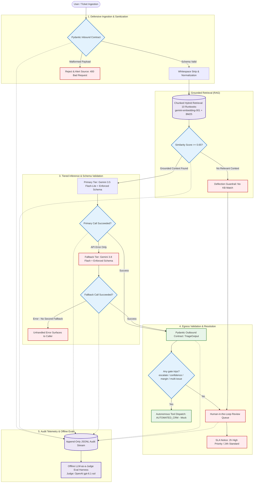

# Case Support Copilot

A RAG-grounded support-triage system: it validates an incoming ticket, retrieves the
matching runbook from a knowledge base, has an LLM classify and draft a grounded reply, and
routes the ticket to an automated handling queue or a human review queue. Telemetry exists
at every step, alongside an LLM-as-judge eval harness for reply and triage quality. The
full eval also runs as a Kestra regression gate (see `orchestration/`);
its daily trigger currently ships disabled, and it is run manually.

This was built for a fictional SaaS company ("OmniFlow") as a portfolio capstone. It
demonstrates defensive ingestion, a retrieval gate that can refuse to answer, tiered
inference with fallback, and measured routing.

Not included: a real CRM system at the end — the dispatch targets are mocks (see Limitations).

## The problem

Support triage is repetitive and can take up a lot of work hours, but automation with AI
can be risky and potentially costly. An LLM that answers from memory can invent policies
(hallucinate). An AI system can waste tokens (processing capital) responding to
out-of-scope inquiries. This system only lets the model draft from an approved knowledge
base, deflects tickets without a knowledge base match to a human (preserving tokens), and
escalates categories that should never be automated (feature requests, SSO/security,
custom exports) regardless of LLM confidence.

## How it works

```
Ticket (JSON)
  → 1. Ingestion    Pydantic InboundTicket validates + normalizes; a malformed ticket never reaches a model
  → 2. Retrieval    Chunked hybrid retrieval over 10 runbooks (gemini-embedding-001
                    cosine over header+section chunks, BM25 keyword rescue below
                    the gate); best score < 0.65 → deflected to human queue, no LLM call
  → 3. Triage       Gemini 3.5 Flash-Lite drafts category / priority / reply from the
                    retrieved knowledge base only (temperature 0, strict JSON schema);
                    on API error only, falls back to Gemini 3.8 Flash
  → 4. Dispatch     Four gates — any one routes to a human: always-escalate
                    category, model confidence < 0.65, retrieval margin < 0.05
                    (ambiguous runbook match), multi-issue ticket → HITL queue +
                    SLA notice; otherwise → AUTOMATED_CRM (mock)
  → 5. Telemetry    Append-only JSONL event at every boundary; metrics.py reports
                    p50/p95 latency, deflection, and routing distribution
```

## Architecture Diagram


Key decisions:

- **Gate before generation.** The similarity gate runs *before* any generative call,
  so out-of-scope tickets cost an embedding, not a completion — and can't hallucinate
  a policy answer.
- **Cross-family eval.** Replies are judged by an OpenAI model (`gpt-6.1-sol`) against
  the Gemini generator, so the judge has no same-family leniency. Pass =
  overall >= 4 (lowered from 5/5 on 2026-10-30 after replay variance was
  measured; pass-at-5 is still reported); a groundedness score of 1–2 caps
  the overall at 2. A second rubric judges the triage decision itself.
  (`capstone/eval/`)
- **Margin over confidence.** The model's verbalized confidence turned out
  to be trimodal (only 0.85 / 0.95 / 0.98 / 1.0 ever reported) and does no
  real gating work; the retrieval margin (best chunk vs. best chunk of any
  other document) is the signal that separates correct routings from
  errors, so dispatch queues any ticket whose margin is under 0.05.
- **Config, not constants.** Model IDs and both 0.65 thresholds live in
  `capstone/config.py`, env-overridable — added after the original fallback model was
  retired mid-project (see Failure notes).

## Evaluation results (50-case golden set, 2026-10-30)

Golden set: 50 tickets with intended-routing labels (schema violations,
deflections, automations, escalations, near-misses, adversarial cases).
Generator `gemini-3.5-flash-lite`, judge `gpt-6.1-sol`, fixed 10-document
index. Per-run dashboards live in `capstone/eval/reports/`.

- Latest local run (reports/20261030-160849): schema 100%, **routing 86%**,
  reply judge overall **3.06** (pass >= 4: 39%), triage judge overall
  **4.18** (pass >= 4: 76%), retrieval top-document accuracy 93.9%.
- Same-day verification run of the Kestra pipeline (execution
  7lwfvv56a83k3es5g804GZ): routing **86%**, reply judge **3.30**,
  triage judge **4.27** — all three regression floors passed
  (80 / 2.7 / 3.8). The 7 routing misses are structural: 4 retrieval
  deflections and 3 margin-gate queues, classified per-run by the
  dashboard.
- The margin floor cost 2 points of headline routing accuracy when it
  landed (86% → 84%) while removing the worst failure mode (confident
  wrong-category automations); accuracy recovered to 86% with the
  multi-issue gate. Judge scores carry real variance between identical
  replays (±0.15 overall), so the gate floors sit ~2 noise-widths below
  the baselines.
- The 10-case smoke benchmark in `main.py` still passes 100% / 100%.
- Telemetry on the committed log (Sep 2026): triage p50 970 ms /
  p95 1,292 ms; retrieval p50 183 ms / p95 220 ms.

## Run it (<5 minutes)

Requires Python 3.12 and a Gemini API key (an OpenAI key is only needed for the judge).

```bash
git clone https://github.com/stricklg/case-support-copilot.git
cd case-support-copilot
pip install -r requirements.txt
# create capstone/.env with:  GEMINI_API_KEY=...   (and OPENAI_API_KEY=... for eval)
cd capstone
streamlit run app.py        # the UI: submit a ticket, see routing + trace
python main.py              # runs the 10-case golden benchmark
python metrics.py           # latency / routing report from telemetry_events.jsonl
```

## Stack

Python 3.12 · google-genai · Pydantic v2 · NumPy (in-memory cosine index) ·
Streamlit · python-dotenv · OpenAI Responses API via stdlib `urllib` (judge only, no SDK)

## Layout

- `capstone/main.py` — pipeline (`run_pipeline`, `triage_and_categorize`), golden set, benchmark
- `capstone/context_engine.py` — chunked hybrid retrieval (vector + BM25 rescue)
- `capstone/schemas.py` / `actions.py` — inbound contract / dispatch + SLA notices
- `capstone/config.py` — model IDs + thresholds
- `capstone/telemetry.py` / `metrics.py` — JSONL audit log / latency & routing reports
- `capstone/eval/` — LLM-as-judge harness (`judge.py`, `rubrics.py`), the
  50-case golden set, the eval runner, per-run dashboards, and the
  regression-gate script (`check_thresholds.py`)
- `orchestration/` — the Kestra regression-gate flow and its runbook
- `capstone/kb/` — the 10 runbooks

## Limitations — read this before the code

- **The KB is a thin synthetic fixture.** 10 short runbooks written for
  this project; fleshing it out is deliberately out of scope so
  before/after comparisons stay valid. Percentages describe this system
  against this fixture — the transferable findings are the mechanisms
  (gates, margin, judging), not the numbers.
- **Prompt injection is a known, measured limitation.** One golden case
  is an injection attempt disguised as a billing ticket; the triage judge
  scores its plausible-but-wrong category as a perfect fit (fit is not
  intent), and the margin gate is what currently routes it to a human.
  A production system needs an upstream injection screen; none is built
  here, by scope decision.
- **The pipeline queries the KB twice per ticket** (once in `run_pipeline` for
  telemetry, again inside triage) — a duplicate embedding call per ticket. Also,
  the deflection branch in `run_pipeline` checks truthiness of a result object that
  is always truthy: dead code. Deflection actually happens inside triage.
- **Downstream is mocked.** The "CRM" and human queue are local functions, not
  integrations. The SLA notice is generated text, not a sent message.
- **No unit tests or CI yet.** The eval harness and its Kestra
  regression gate are the executable checks; pytest + CI come next.

## Failure notes

- [The knowledge base that indexed 8 of 10 documents](docs/failure-kb-indexing.md) —
  an invisible Unicode character in two filenames, a 100% benchmark that couldn't
  see it, and the fix.
