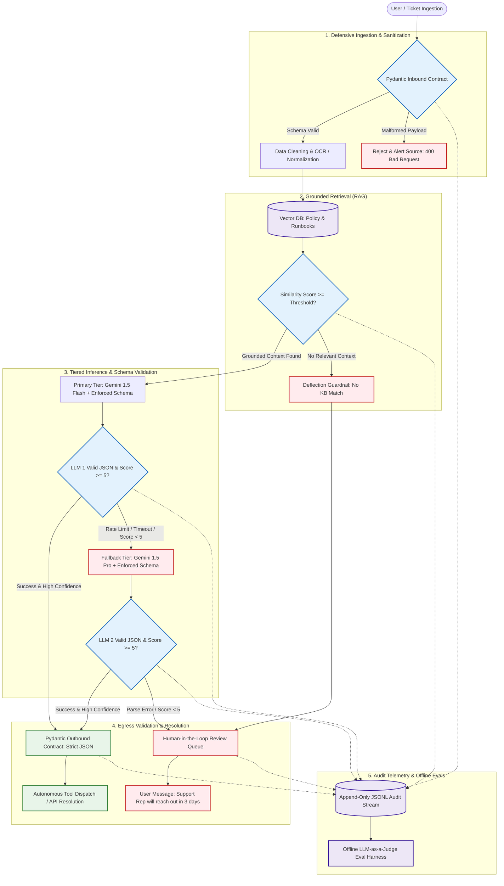

## Architecture Diagram

This will be broken into phases:

Phase 1: The Core Non-Deterministic Engine (Inference & Egress)

Goal: Prove the model can reliably return your required Pydantic schema given mock data.

Work:
Define the Pydantic Outbound Contract (EgressTriageDecision).
Hardcode 2–3 sample tickets and run them directly through your primary model (Gemini 1.5 Flash).
Enforce strict JSON output and verify parsing.
Add the fallback trigger: write the try/except block that swaps to Gemini 1.5 Pro or flags an escalation if validation fails.

Phase 2: Grounding & Retrieval (RAG)
Once the model consumes a prompt and reliably outputs valid JSON, build the context engine that feeds it (Step 2).
Goal: Ensure retrieved policy chunks actually improve and constrain model answers.
Work:
Embed a handful of mock runbook/policy documents into your vector store.
Implement the cosine similarity threshold gate.
Wire the retrieval output into the context slot of your Phase 1 prompt.
Test the deflection branch: verify that an irrelevant query cleanly triggers the safe fallback without hitting the model.
Phase 3: Defensive Ingestion & Pre-processing (Inbound)
Now that your core pipeline functions cleanly with clean mock data, build the front door (Step 1).
Goal: Reject malformed data before it touches retrieval or token-burning models.
Work:
Define the Pydantic Inbound Contract (type validation, string length constraints).
Add basic text normalization or cleanup logic.
Test edge cases: empty strings, oversized inputs, and missing fields to ensure they return a clean 400 Bad Request.
Phase 4: Actions & Escalations (Execution)
Connect the validated egress schema to downstream actions.
Goal: Turn the model's structured decision into real execution.
Work:
Implement the confidence gate: confidence >= 0.85 routes to your mock CRM function; < 0.85 routes to the HITL queue.
Format the user-facing SLA notice for escalated tickets.
Phase 5: Observability & Continuous Evaluation (Telemetry & Evals)
Wrap the end-to-end pipeline in telemetry and measurement (Step 5).
Goal: Make the entire pipeline observable, traceable, and testable against regressions.
Work:
Add the append-only JSONL logger at each state boundary.
Run a batch of 10–20 golden test cases through the complete system to score schema compliance, retrieval precision, and routing accuracy.